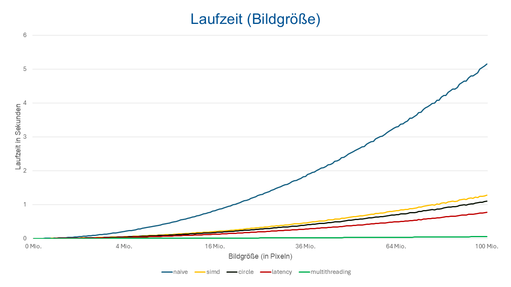
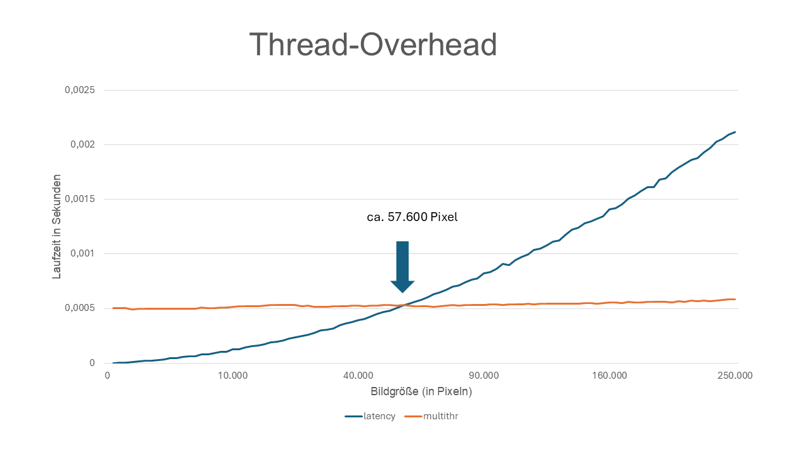
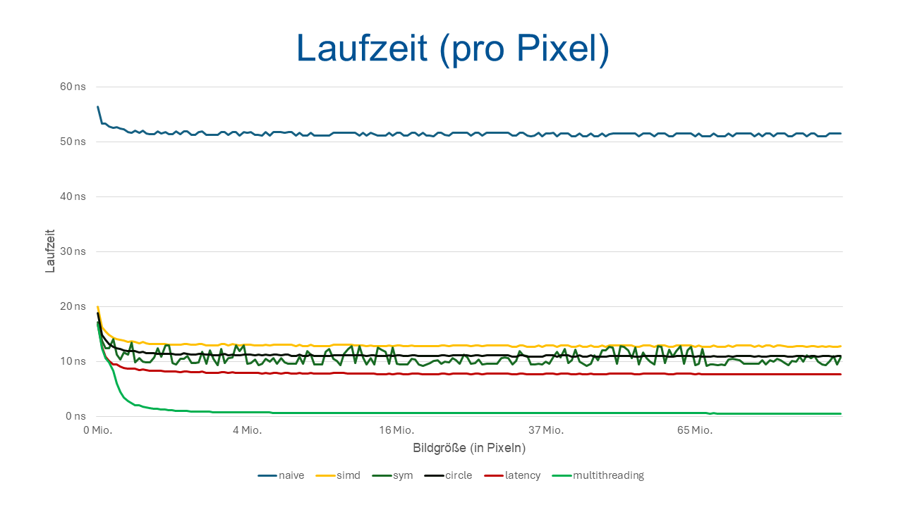

# Projektbericht

## Einleitung

Im Projekt soll eine Bitmap mit einem Trikorn-Fraktal erstellt werden. Die `escapeTime` Funktion berechnet die Anzahl
der Iterationen, nachdem eine Koordinate divergiert. Mit `tricorn` berechnen wir das ganze Bild, welches anschließend 
an `writeBmp` zur Erstellung der Bitmap weitergegeben wird.

## Optimierungen

Mittels profiling wurde `escapeTime` als Flaschenhals festgestellt, weswegen die Optimierungen
hauptsächlich diese Funktion verbessern.

### Naive (`tricorn_V1`)

Die erste Implementierung, mit Fokus auf Korrektheit.

### SIMD (`tricorn_V2`)

Da für jeden Punkt dieselben Berechnungen stattfinden, nutzen wir SIMD um vier Punkte parallel in einem Vektorregister zu verarbeiten.
Ein Nachteil ist, dass die Berechnung erst abbricht, wenn alle vier Punkte divergiert sind oder die maximale Anzahl an Iterationen erreichen.
Dennoch zeigt der Speedup von 3,9x, dass die Berechnung nahezu mit der Breite des Vektorregisters (4 floats) skaliert.

### Symmetry (Verworfener Ansatz)

Trikorn-Fraktale sind an der x-Achse symmetrisch, weswegen man nur die Hälfte des Bilds berechnen muss.
Hierfür berechnen wir das Zentrum des Bildes, also die y-Koordinate an dem der Imaginärteil 0 ist um für jede zu
zeichnende Zeile, die potenzielle Partner-Zeile zu finden (`y_gespiegelt = 2 * center - y`) und zu berechnen, ob der Imaginärteil
exakt das Inverse ist. Da die Imaginärteile Floats sind, ist ein Vergleich nie exakt korrekt, sodass
diese Optimierung in der finalen Version aus Korrektheitsgründen weggelassen wurde.

### Circle (`tricorn_V3`)

In das Trikorn-Fraktal kann man einen Kreis mit Radius 0,25 zeichnen, in dem garantiert kein Punkt divergiert
(Skript: `Circle/findCircleRad.c`). Da die Punkte innerhalb dieses Kreises die maximalen Iterationen durchlaufen würden, 
lohnt es sich, für jeden Punkt dessen Distanz zum Ursprung zu berechnen und zu vergleichen, ob diese kleiner oder gleich 
dem Radius ist. Dadurch konnte ein Speedup von ca. 1,18x zur SIMD erreicht werden.

### Latency Throughput (`tricorn_V4`)

Laut den Intel-Intrinsics ist die Latency von z.B. _mm_add_ps achtmal so hoch wie der Throughput.
In `escapeTime` benötigt fast jede Instruktion das Ergebnis der vorherigen. Dadurch
muss die CPU warten bis Ergebnisse in Registern zur Verfügung stehen, obwohl sie eigentlich schon weiterrechnen könnte. 
Deshalb berechnen wir zwei 4er-Lanes gleichzeitig, also insgesamt 8 Punkte. So können wir beispielsweise zwei add-Operationen (von zwei unterschiedlichen 4er-Lanes) 
hintereinander ausführen, ohne, dass die zweite von dem Ergebnis der ersten abhängig ist. Dadurch wurden die Instructions
per Cycle von 1,95 auf 2,94 erhöht und ein Speedup von ca. 1,4x erreicht. Wir nutzen nur zwei 4er-Lanes, da die Anzahl der xmm-Register begrenzt ist.

### MultiThreading (Hauptimplementierung)

Wir multithreaden entlang der y-Achse mit so vielen Threads, wie das System logische Prozessoren bereitstellt.
Das Multithreading lohnt sich, wie auf der Grafik oben zuerkennen ist, erst ab ca. 57600 Pixel, da sonst der
Thread-Overhead zu groß ist. Da die meiste Rechenlast in der Bildmitte liegt, werden die Threads gleichmäßig über das
gesamte Bild aufgeteilt, sodass es gegenüber `LatencyThroughput` einen Speedup von 14x gibt. Interessant ist, dass die
Testumgebung 24 logische Kerne hat, die Differenz ergibt sich vermutlich durch eine nicht perfekte Lastverteilung.

Insgesamt läuft die Hauptimplementierung ca. 100x schneller als die naive Implementation:

## Benchmarking-Methodik (Zeitmessung)

Die `performanceTest` Funktion misst für jede übergebene Implementierung die Zeit zur Berechnung des Images der Testcase gleich.
Da die reine Berechnungszeit gemessen werden soll werden jegliche I/O, wie das Schreiben der Bitmap ignoriert.
Es werden auch keine irrelevanten Setup Funktionen wie malloc() gemessen. Weiter wird die tricorn Funktion so oft
aufgerufen, bis die summierte Ausführungszeit mindestens eine Sekunde überschreitet.
Außerdem wird die beste Messung aus drei Wiederholungen verwendet, um eventuelle Störungen, die wir nicht mitmessen wollen, zu vermeiden.

Um die Performanz der verschiedenen Versionen besser vergleichen zu können, plotten wir die Performanz dieser, bei
steigender Größe eines quadratischen Bildes (mit ebenfalls steigender Auflösung).

## Testumgebung
- AMD Ryzen 9 5900X (12-Core, 3.7GHz) 32 GB Arbeitsspeicher
- Ubuntu 26.04 (64 Bit), Linux-Kernel  7.0.0-14-generic, kompiliert mit GCC 15.2 mit Flag: -O2
- quadratisches Bild mit Seitenlänge 50 bis 10.000 Pixeln (Schrittweite: 50)
- Resolution = 4/Bildbreite
- n=256
- s=-2,-2

## Test auf Korrektheit

Zur Überprüfung der Korrektheit wurde die Funktion `correctnessTest` implementiert,
die einen Testcase auf allen implementierten Tricorn Versionen ausführt und prüft,
ob alle Ergebnisse mit der naiven Implementierung übereinstimmen. Wird ein Fehler entdeckt, wird das erste
abweichende Byte, sowie die Version die nicht mit der naiven Implementierung identisch ist ausgegeben.

Zunächst wurden sinnvolle Testcases manuell erstellt, die die Basisfälle abdecken.
Darüber hinaus werden gezielt Grenzfälle getestet wie beispielsweise bei SIMD, wenn die Breite nicht durch 4 teilbar ist,
um zu testen, ob die restlichen Pixel ebenso korrekt berechnet wurden.

Zusätzlich werden randomisierte Tests ausgeführt, die alle Konfigurationen zufällig wählen. Der Zufallsgenerator wird 
dabei mit der aktuellen Uhrzeit initialisiert, sodass bei jeder Testausführung neue Zufallswerte entstehen.

Symmetrie wurde außerdem gesondert getestet. Im Test wird (v.a.) die Auflösung auf einen zufälligen, sehr kleinen Wert gesetzt.
Dadurch haben die Imaginärteile der jeweiligen y Koordinaten sehr viele Nachkommastellen.
So hatte beispielsweise eine Koordinate den Imaginärteil 20,293984 und die gespiegelte 20,29838.
Optimierungen, die solche Werte gespiegelt haben, führten zu Fehlern.

Die Korrektheit der Bitmap wurde vor allem dadurch geprüft, ob Standardsoftware in der Lage ist, sie korrekt zu
interpretieren. Ein direkter Vergleich mit extern erzeugten, garantiert korrekten Bitmaps war nicht möglich, da die
spezielle Konfiguration wie Startwert und Auflösung dort nicht zugänglich gemacht wurde.

## Arbeitsaufteilung

- Maximilian: EscapeTime, Optimierungen, Testumgebung
- Timon: Testumgebung, Help Funktion, Benchmarking, Grapherstellung
- Hendrik: Bitmap, Makefile, Kommentare, Verarbeitung der Kommandozeilenargumente 
