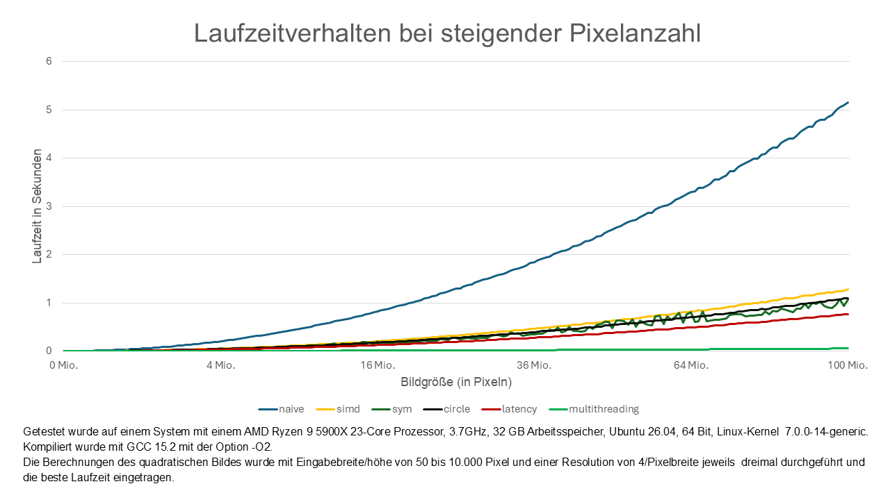
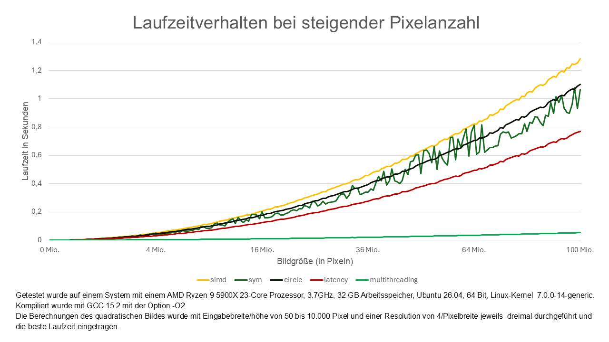

# Projektbericht

## Einleitung

Im Projekt soll eine Bitmap mit einem Trikorn-Fraktal erstellt werden. Die EscapeTime Funktion berechnet die Anzahl
der Iterationen, nachdem eine Koordinate divergiert. Mit Tricorn berechnen wir das ganze Bild, welches dann and writeBmp
gegeben, welches die finale Bitmap schreibt.

## Optimierungen 

### Naive (tricorn_V1)

Die erste Implementierung, mit Fokus auf Korrektheit.

### SIMD (tricorn_V2)

Die Escape-Time-Funktion führt für jeden Punkt die exakt gleichen Berechnungen aus, deswegen nutzen wir SIMD und berechnen vier Punkte gleichzeitig. 
Ein Nachteil ist, dass wenn z.B. bereits 3 Punkte divergiert sind und bloß der letzte nicht, trotzdem solange weiter gerechnet werden muss
bis entweder der letzte Punkt auch divergiert oder die maximale Anzahl an Iterationen erreicht ist.

### Symmetry (Nicht genutzt)

Trikorn-Fraktale sind an der X-Achse symmetrisch, weswegen man nur die Hälfte des Bilds berechnen muss.
Um dies auszunutzen, berechnen wir das Zentrum des Bildes, also die y-Koordinate an dem der Imaginärteil 0 ist.
So können wir für jede zu zeichnende Zeile, die potenzielle Partner-Zeile finden (y_gespiegelt = 2 * center - y) 
und berechnen, ob der Imaginärteil der beiden Kandidaten exakt das Inverse ist. Da die Imaginärteile Floats sind und ein Vergleich deswegen
nie zu 100% korrekt ist, wurde diese Optimierung in der finalen Version weggelassen. 

### Circle (tricorn_V3)

Man kann in das Trikorn_Fraktal einen Kreis mit Radius 0,25 zeichnen, in dem garantiert kein Punkt konvergiert.
(Skript zur Findung des Radius ist unter Circle/findCircleRad.c zu finden)

### Latency Throughput (tricorn_V4)

Laut den Intel-Intrinsics ist die Latency von z.B. _mm_add_ps achtmal so hoch wie der Throughput. 
In Escape Time haben wir eine Dependency Chain, da fast jede Instruktion das Ergebnis der vorherigen benötigt. 
Das ist ineffizient, weil dann immer darauf gewartet werden muss, bis das Ergebnis im Register zur Verfügung steht, 
obwohl die CPU in dieser Zeit rechnen könnte. Deshalb berechnen wir zwei 4er-Lanes gleichzeitig, also insgesamt 8 Punkte.
So können wir bspw. zwei add-Operationen hintereinander ausführen, ohne dass die zweite von dem Ergebnis der ersten
abhängig ist und warten muss. Es werden nur zwei 4er-Lanes genutzt, weil es begrenzte xmm-Register gibt.

### MutliThreading (Hauptimplementierung)

Wir multithreaden entlang der y-Achse mit so vielen Threads, wie das System logische Prozessoren bereitstellt. 
Nur bei sehr kleinen Bildern nutzen wir einen einzigen Thread, da sich der Thread-Overhead sonst nicht lohnt. 
Weil die meiste Rechenlast in der Bildmitte liegt, teilen wir die Threads gleichmäßig über das gesamte Bild auf.

## Benchmarking-Methodik (Zeitmessung)

Es wurde eine einheitliche Funktion performanceTest implementiert, die für jede übergebene Implementierung und jeden 
Testcase genau gleich, die Zeit zur Berechnung des Images misst. Um die reine Berechnungszeit zu messen, wird auch das 
Schreiben der Bitmap ignoriert, da es sich hierbei um I/O handelt. Es werden auch keine irrelevant Setup Funktionen wie malloc() gemessen. 
Weiter wird die tricorn Funktion so oft aufgerufen, bis die summierte Ausführungszeit mindestens eine Sekunde überschreitet. 
Leider zählt hierbei auch das Ausführen der For-Schleife in die Messung, das nach der Vorlesung allerdings passt. 
Außerdem wird die beste Messung aus dreimal Wiederholungen verwendet, um eventuelle Störungen, die wir nicht mitmessen wollen, zu vermeiden.

Um die die Performanz der verschiedenen Versionen besser vergleichen zu können, plotten wir die Performanz dieser, bei
steigender Größe eines quadratischen Bildes (mit ebenfalls steigender Auflösung).
  

## Testumgebung (Korrektheit)

Zur Überprüfung der Korrektheit wurde eine Funktion (correctnessTest) implementiert, 
die einen Testcase auf allen implementierten Tricorn Versionen ausführt und prüft, 
ob alle Ergebnisse mit der naiven Implementierung übereinstimmen. Wird ein Fehler entdeckt, 
können das erste abweichende Byte sowie die Version, die nicht mit der naiven Implementierung identisch ist, 
ausgegeben werden.

Zunächst wurden manuell sinnvolle Testcases erstellt, die die Basisfälle abdecken. 
Darüber hinaus werden gezielt Grenzfälle getestet wie z.B. bei SIMD. Dort werden bei einer Iteration vier Pixel parallel
verarbeitet. Hierbei testen wir bspw. ob bei Breiten, die nicht durch 4 teilbar sind, der Rest auch korrekt berechnet
wird

Zusätzlich werden randomisierte Tests ausgeführt, die Startwerte und Auflösung zufällig wählen.
Um sehr viele dieser Tests durchführen zu können, wird hier die Zeit nicht gemessen.

Symmetrie wurde außerdem gesondert getestet, indem zunächst das Zentrum, also der Punkt mit Imaginärteil 0, auf ein gerades y gesetzt. 
Der Grund ist, dass eine vorhandene Symmetrie Optimierung an dieser Stelle spiegeln muss, da dies der 
einfachste Fall sein sollte. Im Test wird (v.a.) die Auflösung anschließend auf einen zufälligen, sehr kleinen Wert gesetzt. 
Dieses Vorgehen hat sehr zuverlässig Fehler gefunden, da die Imaginärteile der jeweiligen y Koordinaten dann viele 
Nachkommastellen besitzen. So hatte beispielsweise eine Koordinate den Imaginärteil 20,293984 und die gespiegelte 20,29838. 
Optimierungen, die solche Werte gespiegelt haben, führten zu Fehlern.

Die Korrektheit der Bitmap wurde vor allem dadurch geprüft, ob Standardsoftware in der Lage ist, sie korrekt zu
interpretieren. Ein direkter Vergleich mit extern erzeugten, garantiert korrekten Bitmaps war nicht möglich, da die 
spezielle Konfiguration wie Startwert und Auflösung dort nicht zugänglich gemacht wurde.

## Arbeitsaufteilung

- Maximilian: Optimierungen, Testumgebung, Grapherstellung
- Timon: Testumgebung, 
- Hendrik: Bitmap, Makefile, Kommentare, Verarbeitung der Kommandozeilenargumente 

